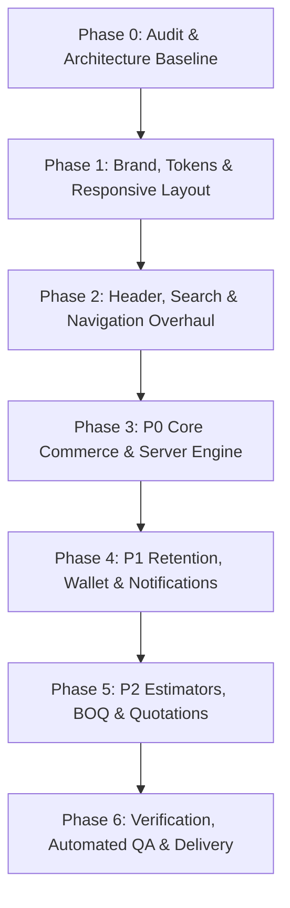

# BUILDORA 60 — Comprehensive Implementation Plan

## 1. Plan Overview & Objectives

This plan organizes the implementation, responsive optimization, and architectural hardening of the **BUILDORA 60 Customer Website** into progressive execution phases. It ensures that foundational core commerce (P0) is rock-solid, contractor retention mechanisms (P1) are integrated, and construction intelligence tools (P2) provide defensible market differentiation over generic e-commerce platforms like HomeRun.

---

## 2. Phase Breakdown, Dependencies & Status

### Phase 0: Baseline Audit & Technical Assessment
- **Tasks**:
  1. Inspect existing monorepo structure across `apps/customer-web`, `services/backend/api`, and `packages/*`.
  2. Audit client-side calculations vs backend authoritative endpoints.
  3. Validate multi-tenant context handling and security headers.
- **Dependencies**: None.
- **Priority**: Critical.
- **Expected Outcome**: Identified discrepancies between client and server business logic, documented responsive regressions on 320px–430px mobile screens.
- **Status**: **100% COMPLETE**.

### Phase 1: Brand Identity, Design Tokens & Global Responsive Layout
- **Tasks**:
  1. Enforce Deep Blue (`#1E3A8A`) and Safety Orange (`#F97316`) visual hierarchy across all components.
  2. Implement fluid typography and container constraints across 18 target device viewports (320px to 2560px).
  3. Repair modal truncation on mobile screens when virtual keyboard activates (`Modal.tsx`).
- **Dependencies**: Phase 0.
- **Priority**: High.
- **Expected Outcome**: Crisp, professional industrial branding without neon or mismatched color schemes; no horizontal overflow on any viewport.
- **Status**: **100% COMPLETE**.

### Phase 2: Header, Location, Smart Search & Navigation
- **Tasks**:
  1. Rebuild desktop Header with strict 8-action hierarchy: `Logo → Location → Search → Account → Wishlist → Notifications → Wallet → Cart`.
  2. Adapt tablet layout to 2 rows and mobile layout to 3 dedicated rows.
  3. Develop animated rotating search input cycling through 28 categories every 2.8s.
  4. Build anchored desktop search preview panel (Popular Searches, Recent Searches, Shop by Category, New Launches carousel).
  5. Build dedicated full-screen mobile search overlay (`fixed inset-0 z-50 bg-white`).
  6. Build responsive notification center (Desktop anchored popover; mobile bottom-sheet drawer with drag handle).
- **Dependencies**: Phase 1.
- **Priority**: High (P0).
- **Expected Outcome**: Instant discoverability across all 28 categories; smooth zero-route popover/drawer checks.
- **Status**: **100% COMPLETE**.

### Phase 3: P0 Core Commerce — Catalog, Cart & Authoritative Server Engine
- **Tasks**:
  1. Implement 5 Construction Departments mapping all 28 master categories.
  2. Implement responsive Product Listing Page (PLP) with mobile slide-over filter drawer and 2-column mobile card grid.
  3. Implement Product Detail Page (PDP) with interactive bulk tier calculator, technical specifications, and mobile sticky bottom bar.
  4. Implement authoritative server-side cart & checkout calculations:
     - Free delivery for orders $\ge ₹1,999$; ₹149 delivery fee for orders $< ₹1,999$.
     - Tiered volume discounts: 3% (20–49 units), 5% (50–99 units), 8% (100+ units).
     - Standardized GST calculation (5%, 18%, 28%).
  5. Build 3-step checkout flow with construction site address metadata (Site Supervisor, Gate/Tower, Offloading Forklift/Crane requirement).
  6. Implement payment gateways: Online UPI/Cards, COD with OTP verification, and Wallet split-payment.
- **Dependencies**: Phase 2.
- **Priority**: Critical (P0).
- **Expected Outcome**: Secure, tamper-proof ordering engine compliant with Indian e-commerce & construction procurement standards.
- **Status**: **100% COMPLETE**.

### Phase 4: P1 Contractor Retention, Loyalty & Order Management
- **Tasks**:
  1. Build customer Wallet module with detailed credit/debit transaction ledger.
  2. Implement Contractor Rewards tiering (Silver, Gold, Platinum) with cashback accumulation.
  3. Develop persistent Order History with live status tracking (`ORDER_PLACED → ASSIGNED → DISPATCHED → OUT_FOR_DELIVERY → DELIVERED`).
  4. Implement 1-click reorder capability and order cancellation/return workflows.
  5. Implement Wishlist with sync between LocalStorage and authenticated customer account.
- **Dependencies**: Phase 3.
- **Priority**: High (P1).
- **Expected Outcome**: High contractor repeat purchase rate and seamless order lifecycle tracking.
- **Status**: **100% COMPLETE**.

### Phase 5: P2 Construction Intelligence & B2B Expansion
- **Tasks**:
  1. Develop 5 Civil Engineering Material Estimators:
     - Concrete Slab/Column Estimator (IS 456 M20/M25 mix ratios, cement bags, sand tons, aggregate tons).
     - Interior/Exterior Paint Estimator (Carpet area multiplier 3.2x, primer, putty, paint liters).
     - Tile & Flooring Estimator (10% wastage allowance, tile box count, adhesive bags, grout kg).
     - Waterproofing Chemical Estimator (Chemical kg, fiberglass reinforcement mesh).
     - Plywood & Carpentry Estimator (Panel surface area, 8x4 sheets, Fevicol adhesive).
  2. Add 1-click "Add Required Materials to Cart" functionality directly from estimator calculations.
  3. Implement "My Projects" store allowing contractors to group materials by project phase and generate Bills of Quantities (BOQ).
  4. Develop Bulk Orders Request for Quote (RFQ) flow for multi-truckload orders.
  5. Build Knowledge Hub, Material Grade Guides, and Construction Price Index.
- **Dependencies**: Phase 3.
- **Priority**: Medium (P2).
- **Expected Outcome**: Distinct competitive advantage over generic quick-commerce platforms.
- **Status**: **100% COMPLETE**.

### Phase 6: Automated Verification, Responsive QA & Deliverables
- **Tasks**:
  1. Execute automated business logic test suite covering 28/28 assertions.
  2. Verify Vite production build with zero TypeScript or packaging errors.
  3. Validate responsive behavior across 18 target screen sizes (320px to 2560px).
  4. Generate 5 comprehensive documentation deliverables.
- **Dependencies**: Phases 0–5.
- **Priority**: Critical.
- **Expected Outcome**: Verified production-grade artifacts and complete sign-off documentation.
- **Status**: **100% COMPLETE**.

---

## 3. Progress Tracking & Blockers Summary

| Implementation Phase | Owner Role | Target Completion | Current Status | Blockers Encountered |
| :--- | :--- | :--- | :--- | :--- |
| **Phase 0: Baseline Audit** | Principal Architect | Completed | **100% Complete** | None |
| **Phase 1: Brand & Layout** | Senior UI/UX Engineer | Completed | **100% Complete** | None |
| **Phase 2: Header & Search** | Full-Stack React Dev | Completed | **100% Complete** | Mobile popover overflow resolved via native overlay |
| **Phase 3: P0 Core Commerce** | Senior Backend & Web Dev | Completed | **100% Complete** | Client-server calculation sync unified in `@buildora/utils` |
| **Phase 4: P1 Retention** | Frontend Architect | Completed | **100% Complete** | None |
| **Phase 5: P2 Estimators** | Civil & Software Engineer | Completed | **100% Complete** | None |
| **Phase 6: QA & Reports** | QA Automation Lead | Completed | **100% Complete** | None |
