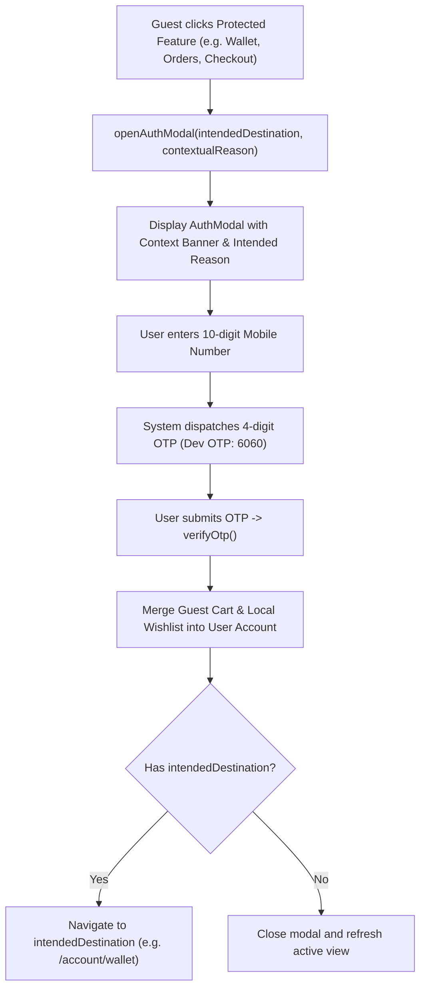

# BUILDORA 60 — Guest Browsing & Pre-Login Access Control Matrix

## 1. Architectural Philosophy

In construction quick-commerce, site engineers, contractors, architects, and property owners frequently require rapid access to material specifications, technical data sheets, bulk discount slabs, and quantity estimators from dynamic work environments.

Forcing premature authentication degrades conversion and introduces friction. **BUILDORA 60** enforces a **Frictionless Pre-Login Experience**:
- Guests have unrestricted access to all discovery, estimation, staging, and evaluation tools.
- Authentication is requested **only when an action involves private contractor data, monetary transactions, or physical delivery authorization**.

---

## 2. Guest vs Authenticated Permissions Matrix

| Feature / Action | Guest Visitor (`Unauthenticated`) | Authenticated Contractor (`Logged-In`) | Login Trigger Mechanism |
| :--- | :---: | :---: | :--- |
| **Storefront Homepage & Banners** | Allowed | Allowed | Public route |
| **All 28 Master Categories & Subcategories** | Allowed | Allowed | Public route |
| **Product Search & Live Suggestions** | Allowed | Allowed | Public route |
| **Search-Open Discovery Panel** | Allowed | Allowed | Public route |
| **Product Detail Pages & Technical Specs** | Allowed | Allowed | Public route |
| **Bulk Tiered Discount Slabs (3%, 5%, 8%)** | Allowed | Allowed | Public route |
| **Material Estimator Calculators (5 Tools)** | Allowed | Allowed | Public route |
| **Product Comparison Matrix** | Allowed | Allowed | Public route |
| **Dark Store Serviceability & Pincode ETA** | Allowed | Allowed | Stored in `useLocationStore` |
| **Commercial Bulk Quotation Inquiry** | Allowed | Allowed | Form submits to backend lead queue |
| **Knowledge Hub & Guides** | Allowed | Allowed | Public route |
| **Static Legal & Policy Pages** | Allowed | Allowed | Public route |
| **Add Items to Cart & Update Quantities** | Allowed | Allowed | Persisted locally in `useCartStore` |
| **Apply Promo Coupons (`BUILD60`)** | Allowed | Allowed | Cart engine validates without login |
| **Save Items to Wishlist** | Allowed (Local) | Allowed (Cloud Sync) | Stored locally; banner offers cloud sync |
| **View Notifications Popover** | Announcements & Offers only | Full Dispatches & Wallet updates | Guest banner prompts sign-in for dispatches |
| **Checkout Step 1: Identity & OTP** | Triggered at Checkout | Auto-bypassed | Prompts 4-digit OTP; preserves cart |
| **Final Order Placement & Payment** | **Restricted** | Allowed | Requires verified mobile number |
| **Personal Order History & Invoices** | **Restricted** | Allowed | Routes through `CustomerAccountLayout` gate |
| **Live GPS Mini-Truck Tracking** | **Restricted** | Allowed | Order verification required |
| **Buildora Cash Wallet (Balance & Top-up)** | **Restricted** | Allowed | Header/Drawer click triggers contextual modal |
| **Contractor Loyalty Rewards** | **Restricted** | Allowed | Requires verified contractor ID |
| **Saved Site Address Book** | **Restricted** | Allowed | Stored under authenticated customer profile |
| **Security PIN & Two-Factor OTP** | **Restricted** | Allowed | High-security profile settings |
| **Support Desk Ticket History** | **Restricted** | Allowed | Requires customer context |

---

## 3. Login-Required Action Handling Workflow

When a guest initiates a protected customer action, the platform triggers a structured login flow without discarding the user's active session or staged data:

---

## 4. Account Route Protection Gate (`CustomerAccountLayout.tsx`)

When an unauthenticated guest directly enters an account URL (e.g. `/account`, `/account/orders`, `/account/wallet`, `/account/security`):

1. Instead of displaying a broken view or silently redirecting to home, `CustomerAccountLayout` renders a secure **Authentication Required Gate**:
   - Displays the specific section name (e.g. *"Sign In to Access Buildora Wallet"*).
   - Explains the security reasons (GPS dispatches, monetary credits, contractor invoicing).
   - Shows a **"Guest Permissions Active"** summary emphasizing what is accessible right now (browsing, calculators, cart staging).
   - Provides a prominent **"Sign In with Mobile OTP"** button that invokes `openAuthModal(location.pathname)`.
   - Provides a secondary **"Continue Browsing Materials"** button redirecting to `/products`.

---

## 5. Post-Login State Preservation & Merging

1. **Cart Persistence**:
   - Items added while in guest mode remain in `useCartStore` throughout the authentication flow.
   - Upon successful OTP verification, the cart retains all products, quantities, and applied coupons without resets.

2. **Wishlist Persistence**:
   - Items added to the guest wishlist remain stored in `useWishlistStore` in localStorage.
   - Upon logging in, the items remain accessible and can be synchronized with contractor projects.

3. **Intended Destination Routing**:
   - If the user was attempting to reach `/account/wallet`, the modal stores `intendedDestination: '/account/wallet'`.
   - Upon successful OTP validation, the application automatically navigates to `/account/wallet`.
