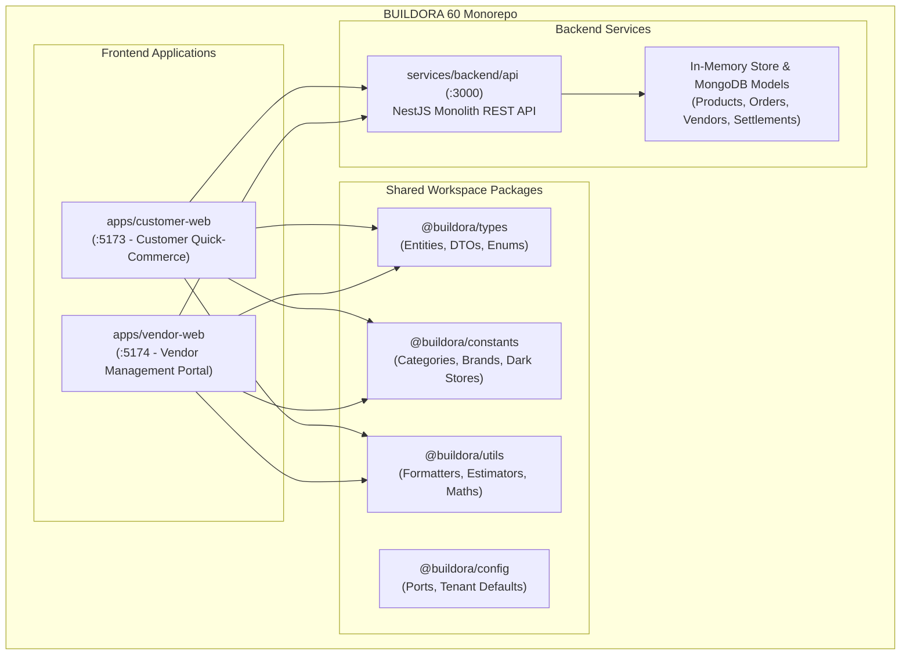

# BUILDORA 60 — Vendor Portal Technical Architecture

---

## 1. System Architecture Overview



---

## 2. Vendor Portal (`apps/vendor-web`) Application Structure

```
apps/vendor-web/
├── package.json               # Dependencies: react, react-dom, react-router-dom, zustand, lucide-react, tailwindcss
├── vite.config.ts             # Port 5174, path aliases @/*
├── tsconfig.json              # Extends tsconfig.base.json
├── index.html                 # Page shell with Inter font
└── src/
    ├── main.tsx               # App bootstrap & providers
    ├── App.tsx                # BrowserRouter & App Routes
    ├── index.css              # Tailwind CSS styles & brand palette
    ├── config/
    │   └── env.ts             # VITE_API_URL, tenant config
    ├── types/
    │   └── vendor.ts          # VendorProfile, VendorOrder, VendorProduct, Settlement
    ├── store/
    │   ├── useVendorAuthStore.ts    # Vendor authentication, token, state
    │   ├── useVendorProductStore.ts # Product CRUD & bulk pricing
    │   ├── useVendorOrderStore.ts   # Order list & status actions
    │   └── useVendorInventoryStore.ts # Stock tracking & adjustments
    ├── services/
    │   └── vendorApi.ts       # Typed REST API client for vendor endpoints
    ├── layouts/
    │   ├── VendorAuthLayout.tsx     # Clean auth split layout
    │   ├── VendorAppLayout.tsx      # Sidebar + Header + Main container
    │   └── components/
    │       ├── VendorSidebar.tsx    # Collapsible sidebar with navigation items
    │       └── VendorHeader.tsx     # Store name, status pill, notifications, profile
    ├── components/
    │   ├── ui/                # Button, Modal, Badge, Card, Input, Select, Table
    │   └── common/            # MetricCard, StatusBadge, EmptyState, PageHeader
    ├── pages/
    │   ├── auth/              # Login, Register, Forgot Password
    │   ├── onboarding/        # Multi-Step Business Onboarding Wizard
    │   ├── dashboard/         # Real KPI Metrics, Revenue Trends, Recent Orders
    │   ├── products/          # Product List, Add/Edit Product Modal, Specifications
    │   ├── bulk-pricing/      # Bulk Tier Management & Quantity Discounts
    │   ├── inventory/         # Stock Listing, Stock Adjustment Modal, Low-Stock Alerts
    │   ├── orders/            # Order List, Order Details Drawer, Fulfillment Status
    │   ├── delivery/          # Warehouse & Serviceability Dispatch Configuration
    │   ├── pricing/           # Price Updates, MRP, Margin Calculators & History
    │   ├── returns/           # Return & Cancellation Request Review & Actions
    │   ├── earnings/          # Payouts, Commissions, Settlements & Statements
    │   ├── reports/           # Real Data Reports (Sales, Stock, Orders) with CSV Export
    │   ├── notifications/     # Notification Center with Filter & Mark-Read
    │   └── settings/          # Store Profile, Bank Details, Team Roles
    └── routes/
        ├── index.tsx          # Route definitions & guards
        └── ProtectedRoute.tsx # Auth & Onboarding state verification
```

---

## 3. Backend Vendor Module Architecture (`services/backend/api`)

- **Module**: `services/backend/api/src/modules/vendors/`
- **Controller**: `VendorController` (`@Controller('api/v1/vendor')`)
- **Endpoints Implemented**:
  - `POST /auth/login`, `POST /auth/register`, `GET /auth/me`, `POST /auth/logout`
  - `GET /onboarding`, `PUT /onboarding`, `POST /onboarding/submit`
  - `GET /dashboard/metrics`, `GET /dashboard/charts`
  - `GET /products`, `POST /products`, `GET /products/:id`, `PUT /products/:id`, `DELETE /products/:id`
  - `GET /products/:id/bulk-pricing`, `PUT /products/:id/bulk-pricing`
  - `GET /inventory`, `POST /inventory/adjust`
  - `GET /orders`, `GET /orders/:id`, `PUT /orders/:id/status`
  - `GET /returns`, `PUT /returns/:id/status`
  - `GET /settlements`, `GET /settlements/summary`
  - `GET /delivery/settings`, `PUT /delivery/settings`
  - `GET /reports/sales`, `GET /reports/inventory`
  - `GET /notifications`, `PUT /notifications/:id/read`, `PUT /notifications/read-all`

---

## 4. Security & Isolation Strategy

1. **Server-Side Token Verification**:
   - Every request validates the vendor's Bearer JWT and extracts `vendorId` and `tenantId`.
2. **Vendor Data Scoping**:
   - Products, stock records, orders, and settlements are strictly filtered by `vendorId`.
3. **Multi-Tenant Protection**:
   - Queries enforce `tenantId === request.tenantId` to ensure cross-tenant safety.
